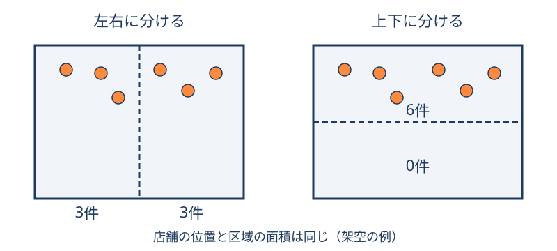

# MAUP：集計範囲で結果が変わる問題

**同じデータでも、どの大きさ・区切り方でまとめるかによって、見える傾向や統計結果が変わる。** これがMAUP（Modifiable Areal Unit Problem、可変単位地区問題）である。市区町村別の店舗密度、メッシュ別の人口、地域同士の類似度などを読むときに関係する。[1]

計算ミスがなくても起こるため、データと計算方法に加え、「どの範囲を一つの地域としたか」を記録する。

## まず、同じ6店舗を区切ってみる { #example }

図：説明用に作成した架空の6店舗。外枠・店舗の位置・二区域の面積は同じで、境界の向きだけが違う。実地域の測定結果ではない。

左の図なら「両区域に均等に店舗がある」、右なら「一方に集中している」と読める。全体の6店舗は変わっていない。この例は集計で分布の見え方が変わる入口であり、相関や予測精度の変化を実証するものではない。

## 大きさと区切り方を分ける { #effects }

| 種類 | 何を変えるか | 例 |
| --- | --- | --- |
| スケール効果 | 集計単位の大きさ・集約の段階 | 町丁目別から市区町村別へまとめる |
| ゾーニング効果（区割り効果） | 同程度のスケールで境界や組み合わせを変える | 同じ面積の区画で、境界の位置・向きを変える |

区画の形や面積が不均一な実データでは、両者が同時に変わることもある。大きい区域での答えが常に誤り、小さい区域なら常に正しいという意味ではない。異なる範囲では、答えている問い自体が違う場合がある。[1]

問題は件数の見え方にとどまらない。FotheringhamとWongの研究は、重回帰・ロジット回帰の推定値がスケールや区割りに敏感になり得ることを扱う。特定の分析で、変化の方向や大きさがあらかじめ決まるわけではない。[2]

## 駅周辺のPOIではどう考えるか { #station-window }

駅を中心にした正方形を1km四方から1.6km四方へ広げる例を考える。面積は1km²から2.56km²になり、広げた後の約61％は新たに加えた外側の帯である。これは幾何計算であり、施設が61％増えるという意味ではない。

外側に大学や大型商業施設があれば、カテゴリ構成比や類似地域の順位が変わる可能性がある。ただし、変化量はデータを確かめなければ分からない。正方形の中心から辺まで500mでも、角までは約707mなので、「半径500m」や「徒歩圏」とも異なる。

典型的なMAUPは、地域を区画に分けて集計する問題である。駅ごとに置く重なり得る範囲にも集計範囲への依存はあるが、同じPOIを複数駅で数えることや、比較対象の選び方も別に点検する。駅周辺の分析で起きた変化を、すべてMAUPだけで説明しない。

| 比較で変えたもの | 主に確かめること |
| --- | --- |
| 同じ駅の集計範囲の大きさ | 範囲を広げたときの特徴量・順位の変化 |
| 同じ面積で境界・起点を変更 | どの施設が入れ替わるか |
| 重なる駅を除いて再学習 | 対象集団と重複の影響。範囲サイズ変更とは別の実験 |
| 同じデータで学習の初期値を変更 | アルゴリズムの安定性。MAUPの検査にはならない |

## 「その範囲でよいか」は目的から考える { #context }

店舗の集まり方を比較したいなら、同じ条件の正方形は一つの出発点になる。一方、「通勤客が朝に立ち寄れるカフェ」を知りたいなら、駅の出入口、歩ける道路、営業時刻も必要になる。近い距離にあっても、川や線路を越えられない場合がある。

人の行動や健康への環境の影響を調べる研究には、分析に使う範囲が、実際に影響を受ける場所・時間と合っているかというUGCoP（不確かな地理的文脈の問題）がある。[3] 単に区画を細かくすることとは別の問いであり、POIの分布図だけで人の生活圏を確認したことにはならない。

## 結果の揺れを確かめる { #sensitivity }

次は分析設計の提案である。唯一の正解となる範囲を探すより、目的と試した条件を説明できるようにする。

1. **問いを決める。** 店舗の分布、歩いて利用できる施設、売上予測などを区別する。
2. **基準条件を残す。** データの版、カテゴリ、起点、形、大きさ、重複の扱いを記録する。
3. **一つずつ変える。** まず大きさ、次に同程度の面積で形・位置を比較する。同時に多くを変えると原因が分かりにくい。
4. **順位の前に中身を見る。** 件数・密度・構成比がどれだけ変わったか、順位が近い候補が多かったかを調べる。
5. **安定した範囲と限界を書く。** 試した条件で順位が変わらなくても、利用者の感覚や目的への適合まで保証しない。

上位10件同士の共通数が3件なら、集合の一致度であるJaccard係数は `3 ÷ (10 + 10 − 3) ≈ 0.176` となる。これは計算例で、順位の順番は評価しない。複数駅を平均する場合は駅ごとに計算してから平均する。「平均で7〜8件入れ替わった」だけから平均Jaccard係数を厳密には求められない。

## AIや埋め込みを使えば解消するか

地域ごとのPOI集計をAIへ渡す場合、入力の時点で選んだ範囲と集約方法が結果を左右し得る。数値を埋め込みへ変換しただけで、その前提がなくなるとは言えない。モデルを変える比較と、集計範囲を変える比較を分けて記録する。

同心帯や出入口別の集計は、まとめる前の違いを残す工夫になる。ただし、列を増やすほど常によくなるわけではなく、比較目的に合うかを確かめる。こうした設計上の含意は、特定モデルの性能を実測した結論ではない。

## 次に読む

- [空間結合と集計](../methods/spatial-join-and-aggregation.md)：境界上の点と二重計上を確認する。
- [POIの比較と地域特徴量](../data/poi-open-data-comparison.md)：類似検索・クラスタリングの公開事例を見る。
- [空間分析への埋め込み](../methods/spatial-embeddings.md)：入力の表現と用途を整理する。
- [分析結果の検証](../methods/spatial-analysis-validation.md)：予測の評価条件と適用範囲を決める。

## 出典と確認範囲

- [1] [Esri GIS Dictionary: Modifiable Areal Unit Problem](https://support.esri.com/en-us/gis-dictionary/modifiable-areal-unit-problem)（2026-10-18本文確認。定義・2種類の効果）
- [2] [Fotheringham & Wong (1991), The Modifiable Areal Unit Problem in Multivariate Statistical Analysis](https://journals.sagepub.com/doi/10.1068/a231025)（2026-10-18出版社の書誌・要旨確認。全文未確認）
- [3] [Chen & Kwan (2015), Contextual Uncertainties, Human Mobility, and Perceived Food Environment](https://pubmed.ncbi.nlm.nih.gov/26180982/)（2026-10-18著者論文の要旨確認。食環境の時間・移動・文脈）

説明の題材には提供資料を参考にしたが、未公開の個別実験値は転載していない。図と数値例は独自の模式例・計算である。
