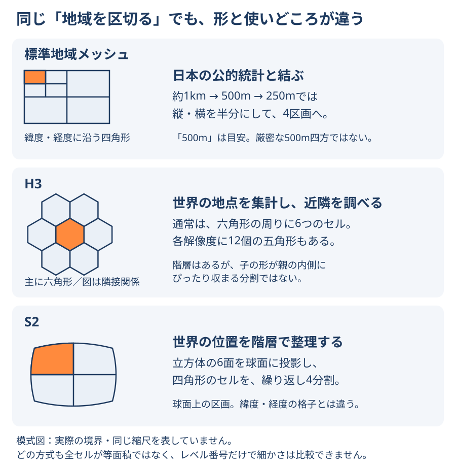

# メッシュと地域の区切り方

メッシュは地図を一定の規則で区切る方法の総称で、単一の規格名ではない。区画にIDを付けると、地点を集計したり別の統計と結合したりできる。どの区画も、商圏や生活圏の正解を自動的に示すものではない。

## 形と使いどころを見比べる

<figure markdown="span">
  
  <figcaption>標準地域メッシュ・H3・S2の区切り方と使いどころ。形を理解するための模式図で、実際のセル境界や同じ縮尺を表さない。H3の図は親子ではなく隣り合うセルを示す。</figcaption>
</figure>

まずは「日本の統計表と結ぶなら標準地域メッシュ」「六角形の近隣を扱うならH3」「球面の四角形を階層的に扱うならS2」と捉えると違いをつかみやすい。ただし用途は重なり、H3でもS2でも地点の集計や位置検索はできる。

標準地域メッシュの約1kmから500m、250mへの細分化は4分割である。それより粗い階層まで、すべて4分割という意味ではない。S2は立方体の6面を球面に投影したセルから始め、各セルを繰り返し4分割する。H3にも階層はあるが、子セルの形が親セルの内側へ完全に収まるとは限らない。形が整って見えても、どの方式も地球上で全セルが同じ面積になるわけではない。

## 目的から選ぶ

| 目的 | 候補 | 確認すること |
| --- | --- | --- |
| 日本の公的統計と結ぶ | 標準地域メッシュ | コードの桁、測地系、調査年、秘匿・欠損 |
| 世界規模の集計や位置検索 | H3・S2 | セルの面積差、階層・近隣の規則 |
| Web地図を配信する | XYZタイル・Quadkey | 配信用区画と分析用区画の目的の違い |
| 固定した分析条件を作る | 独自の正方形・六角形 | 座標系、セル幅、原点、境界上の点の所属 |

10月24日の比較記事は9方式を扱う。吉祥寺の例では約500mの標準地域メッシュが0.2615km²、H3のresolution 8が0.6756km²だった。レベル番号は方式ごとに意味が違い、数字だけでは面積をそろえられない。H3やS2も完全な等面積ではない。値は記事の計算例である。

## 標準地域メッシュのコードと結合

10月25日の解説では、約1km・500m・250mをそれぞれ8・9・10桁コードで扱う。約500mは2分の1地域メッシュ、約250mは4分の1地域メッシュで、メートル単位の正方形ではない。コードは文字列で保持し、親へ集約する際も子の欠損や秘匿を0とみなさない。

記事の人口・POI結合例は、駅中心1km四方と交差する500mメッシュを切り取らず9区画すべて採用した約2.353km²である。2020年人口28,487人とOverture 2026-09-23.0のPOI登録4,057件を結合している。同じコードでも時点や指標の意味は一致せず、人口当たりPOI数だけで需要や出店適性は判断できない。公式500m人口表との直接照合は記事でも未実施とされる。

## 次に読む

- [MAUP](maup.md)：区画の変更による結果の揺れを知る。
- [座標参照系](coordinate-reference-systems.md)：距離・面積の計算条件を選ぶ。
- [H3](../tools/h3.md)：階層とセルIDの扱いを詳しく読む。
- [全国メッシュのWeb配信](../methods/national-grid-web-delivery.md)：集計した区画を公開する構成を知る。

## 出典

- [総務省統計局：地域メッシュ統計について](https://www.stat.go.jp/data/mesh/m_tuite.html)（2026-10-26確認）
- [H3：Overview](https://h3geo.org/docs/core-library/overview/)・[階層の包含関係](https://h3geo.org/docs/highlights/indexing/)（2026-10-26確認）
- [S2：S2 Cell Hierarchy](https://s2geometry.io/devguide/s2cell_hierarchy.html)（2026-10-26確認）

- [地図のメッシュ入門](https://blog.masahiko.info/entry/2026/10/24/153000)（2026-10-26確認）
- [日本の標準地域メッシュ入門](https://blog.masahiko.info/entry/2026/10/25/115000)（2026-10-26確認）

記事の説明と報告値を確認したもので、コードの実行や統計の再集計は行っていない。
