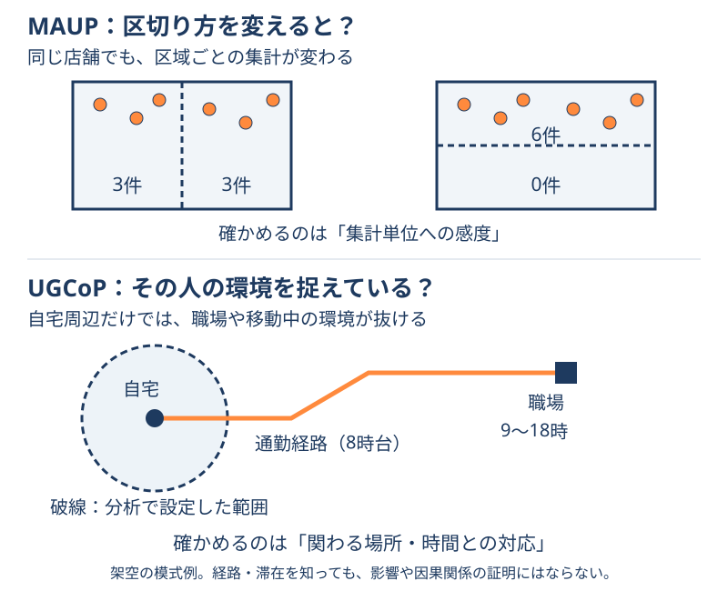

# UGCoP：実際に関わる場所と時間を捉える

**自宅の周りを調べただけで、その人が一日に接する環境を説明できるだろうか。** 通勤先、買い物先、移動経路では、周囲の環境も過ごす時間も違う。このように、分析で設定した範囲と、実際に影響を受ける場所・時間がずれる不確かさを扱うのがUGCoP（Uncertain Geographic Context Problem）である。ここでは「不確かな地理的文脈の問題」と訳す。[1]

「文脈」は、その人の行動や結果に関わる周囲の条件を指す。位置情報の測定誤差だけの話でも、地図データが古いという話だけでもない。

## MAUPと何が違うか { #maup-vs-ugcop }

図：独自に作成した架空の模式例。上段は同じ6店舗と同面積の二区域を比較する。下段の通勤経路と滞在時間は、影響を受ける環境を考える手掛かりであり、因果関係を証明するものではない。

| 観点 | MAUP | UGCoP |
| --- | --- | --- |
| 中心となる問い | 集計の大きさ・区切り方を変えると、結果がどれだけ変わるか | 設定した場所・時間が、調べたい影響に合っているか |
| 身近な例 | 店舗を町丁目別と市区町村別で集計すると分布の見え方が変わる | 自宅周辺の店舗数で食環境を表したが、主に職場近くで食事をしていた |
| 確かめる方向 | 複数の大きさ・区割りで比較する | 誰が、どこで、いつ、どれくらい関わる環境かを確かめる |

両者は関係するが、同じ問題ではない。[1][2] 例えば、自宅周辺を500m・800m・1kmで調べ、結果が安定していても、職場での食事が重要なら調べる場所が合っていない可能性がある。**範囲を変えても安定することと、目的に合う範囲を捉えることは別である。** これは違いを説明する架空の例で、実測結果ではない。

MAUPの境界による違いは[6店舗の図解](maup.md#example)で確認できる。

## 場所だけでなく時間も見る { #space-time }

Kwanの原論文は、影響に関わる区域の不確かさに加え、影響を受けた時刻と継続時間の不確かさを挙げている。[1] 以下はそれを理解するための模式例である。

| 見落としやすい条件 | 何がずれるか |
| --- | --- |
| 自宅だけを起点にする | 職場・通学先・移動中の環境が抜ける |
| 一日のどの時刻でも同じとみなす | 朝には閉まっている店舗を、朝に利用できる施設として数える |
| 通過と長時間滞在を同じに扱う | その環境と関わった長さの違いが消える |
| 一日の記録を日常の代表とみなす | 平日と休日などの違いを取りこぼす可能性がある |

どの時間幅や場所が重要かは、調べる現象によって異なる。「長く滞在した場所ほど必ず重要」と一律の重みを決めることも避ける。

## 駅周辺のカフェで考える { #poi-example }

「駅周辺に登録されたカフェの分布を比べる」なら、固定した正方形は比較条件の一つになる。人の行動への影響を説明していない段階で、すべてのPOI集計をUGCoPの実証例と呼ぶ必要はない。

一方、「朝の通勤客が利用できるカフェを調べる」なら、代表点からの距離だけでは足りない。分析の仕様として、次のように整理できる。

| 決める条件 | 設計例 |
| --- | --- |
| 誰・いつ | 駅から外へ出る通勤客、平日の朝7〜9時 |
| 起点・移動 | 利用する出入口と歩ける道路。直線距離と区別する |
| 対象店舗 | その時間に営業する店。営業時間不明は別に数える |
| 言える範囲 | 到達・利用できる可能性。実際の来店や購入は別途確認する |

これはAtlasの設計例であり、特定駅で測定した結果ではない。食へのアクセスを扱うChenとKwanの研究も、移動、時間、本人が認識する環境を考慮する必要性を論じている。[3]

## 対処するときの順序 { #checks }

以下は概念を分析に生かすための確認手順である。

1. **説明したい対象を決める。** 施設の分布、利用可能性、実際の行動、健康などの結果を区別する。
2. **関わる場所と時間の仮説を書く。** なぜ自宅、駅、経路などを調べるのかを説明する。
3. **使うデータが何を表すか確かめる。** 徒歩圏は到達可能性、GPSは観測された移動、行動日誌は申告された活動を表す。どれも単独で「影響の真の範囲」を保証しない。
4. **別の設定と比べる。** 起点、曜日・時間帯、範囲、滞在時間の扱いを変え、結論が変わる条件を残す。
5. **分からない部分も示す。** 行動を測っていなければ、POIの数から利用実態や因果関係を断定しない。

移動履歴を使う場合は、目的に必要な範囲と[プライバシーへの配慮](../methods/location-data-privacy.md)も決める。UGCoPへの対応が、常に個人の詳細な移動履歴の収集を必要とするわけではない。

## AI・埋め込みとの関係

自宅周辺のPOIだけを数値や埋め込みにしても、含めていない職場や時間帯の情報を捉えたことにはならない。モデルの性能だけでなく、入力が目的に合う環境を表しているかを確認する。これは入力設計への含意であり、特定のAIの性能を測定した結論ではない。

## 次に読む

- [MAUP](maup.md)：集計単位への感度と比較条件を整理する。
- [POIの比較と地域特徴量](../data/poi-open-data-comparison.md)：施設の分布と需要・人出を分ける。
- [人流データの種類](../data/human-flow-data-types.md)：観測する移動とデータの単位を確認する。
- [分析結果の検証](../methods/spatial-analysis-validation.md)：予測・説明の検証へ進む。

## 出典と確認範囲

- [1] [Kwan (2012), The Uncertain Geographic Context Problem — Illinois Experts](https://experts.illinois.edu/en/publications/the-uncertain-geographic-context-problem/)（2026-10-18、大学研究情報サイト掲載の著者論文要旨・書誌を確認。全文未確認）
- [2] [Esri GIS Dictionary: Modifiable Areal Unit Problem](https://support.esri.com/en-us/gis-dictionary/modifiable-areal-unit-problem)（2026-10-18、定義本文確認）
- [3] [Chen & Kwan (2015), Contextual Uncertainties, Human Mobility, and Perceived Food Environment](https://doi.org/10.2105/AJPH.2015.302792)（2026-10-18、検索で取得できた出版社掲載要旨を確認。全文未確認）

提供資料は論点整理の参考とし、未公開の実験値・会話を転載していない。本文の生活場面と仕様表は独自の説明例である。
