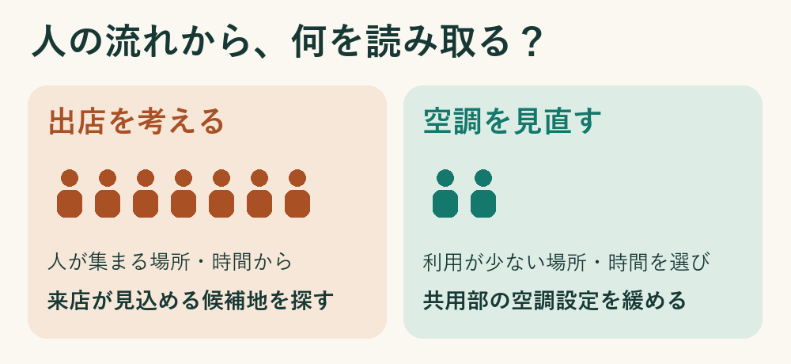
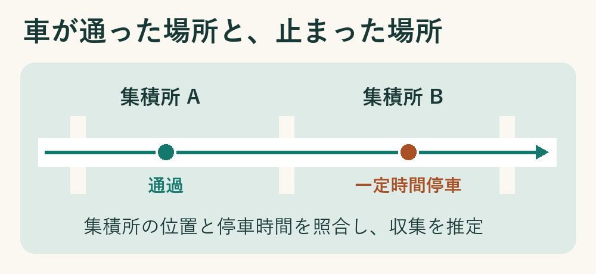

# 週刊GeoAI #10（2026年11月6日）

人流データで出店先を考えるとき、私がまず見たくなるのは、人が集まる場所や時間帯です。今週のビル空調の実証で面白いと思ったのは、コストを抑えたいときには、むしろ人が少ない時間に目を向けることでした。

同じビルでも、お昼のロビーと夕方のロビーでは使われ方が違います。曜日で一律に設定を変えるより、「この場所で、この時間なら、どこまで空調を緩められるか」と考える。商圏分析とは違う、人流データの使い道が見えてきます。

*人の多さを、出店担当者とビル管理者の視点で読む。*

本誌では、地図・位置情報・POIなどの地理空間データを、機械学習やデータサイエンスの手法で分析・活用する領域をGeoAIと呼びます

## 今週の注目ニュース

### 1. [人が少ない場所と時間を選んで空調を調整、赤坂のビルで実証](<https://prtimes.jp/main/html/rd/p/000000644.000001379.html>)

日鉄興和不動産、アジラ、JDSCは、赤坂インターシティAIRの低層階にある共用部3フロアで、防犯カメラなどからエリア別・時間帯別の混雑を把握し、空調の温度設定を調整しました。3社の発表では、対象フロアの空調消費エネルギーが平均27％減少。夏季の最大削減率は54％で、これは特定のエリア・時間帯を通常運用時と比べた値です。利用者アンケートと巡回評価では快適性に差は見られなかったとしています。

### 2. [PostGIS 3.7.0公開、「この地点から一定距離内」の検索を高速化](<https://postgis.net/2026/10/PostGIS-3.7.0/>)

PostGISは、データベースのPostgreSQLに、点や線、面を保存し、その位置関係を調べる機能を加える拡張です。例えば店舗一覧から「駅から500m以内の店」を探せます。今回、この距離判定が高速になり、隣り合う区域が共有する境界線を取り出す機能も加わりました。

### 3. [ゼンリンとPreferred Networks、地図の情報をAIで使うために提携](<https://www.zenrin.co.jp/information/public/261029.html>)

両グループが着目するのは、地点の座標に加え、そこに何があり、周囲に何があり、どう変わってきたかという情報です。これらをAIが扱える形に整理し、地域の需要予測や出店候補地の選定などに使うモデルやサービスの共同開発を目指します。

## 短報

### 4. [国土数値情報をQGISの地図から探せる「KSJ Browser」](<https://qgis.mierune.co.jp/posts/howto_plugin_ksj-browser>)

MIERUNEが使い方を公開。地図上で欲しい区画を選び、国が公開する地域データを直接読み込めます。過去の年度を指定したり、ZIPの中から必要なファイルだけを選んだりできます。

### 5. [QGISプラグイン「AutoGIS」、AIが実装資料を参照可能に](<https://plugins.qgis.org/plugins/AutoGIS/version/1.0.3/>)

Prince Suthar氏が開発するプラグインの更新です。AIが地図処理のコードを書く際に、その実装に使う資料を検索できるようになりました。同名の研究プロジェクトやMapsukeとの違いは[GeoAIアトラス](https://isshiki.github.io/weekly-geoai/atlas/tools/mapsuke/#autogis)にまとめています。

### 6. [Google Mapsの施設詳細に、時間帯別の混雑を表示](<https://developers.google.com/maps/documentation/javascript/releases#2026-11-04>)

開発者がWebサイトに組み込む地図で、施設が普段どの時間帯に混むかを表示できるようになりました。情報がある施設では、現在の混雑状況も表示できます。

## 今週の地図

### 7. [THE MAPで富士山の見える場所を探す](<https://themap.jp/map/64bfc61411a489290400131c>)

富士山を眺めるなら、どこに立つとよさそうでしょうか。リンク先では、富士山を望むスポットを地図でたどれます。Digroundで作られた地図を読める公開サイトが、11月3日に「THE MAP」への刷新を発表しました。[運営元の発表](https://prtimes.jp/main/html/rd/p/000000035.000023226.html)

## 地図とAI、はじめの一歩

**ごみ収集車は、もうこの通りを回った？**

住民から問い合わせを受けたとき、収集担当者が見たいのは、車が今どこにいるかより、その集積所で止まったかどうかです。盛岡・紫波地区などで行われた実証では、収集車の走行記録と集積所の位置を重ね、集積所のそばで一定時間止まったら、収集したと推定しました。すぐ隣に別の集積所があり、取り違えた例もあります。地図で当たりをつけると、現場に何を確かめればよいかが見えてきます。[内閣府の実証紹介・検出例の図](https://qzss.go.jp/usage/userreport/njk_250806.html)

*収集担当者が走行記録を読む仕組みを描いた模式図。*
