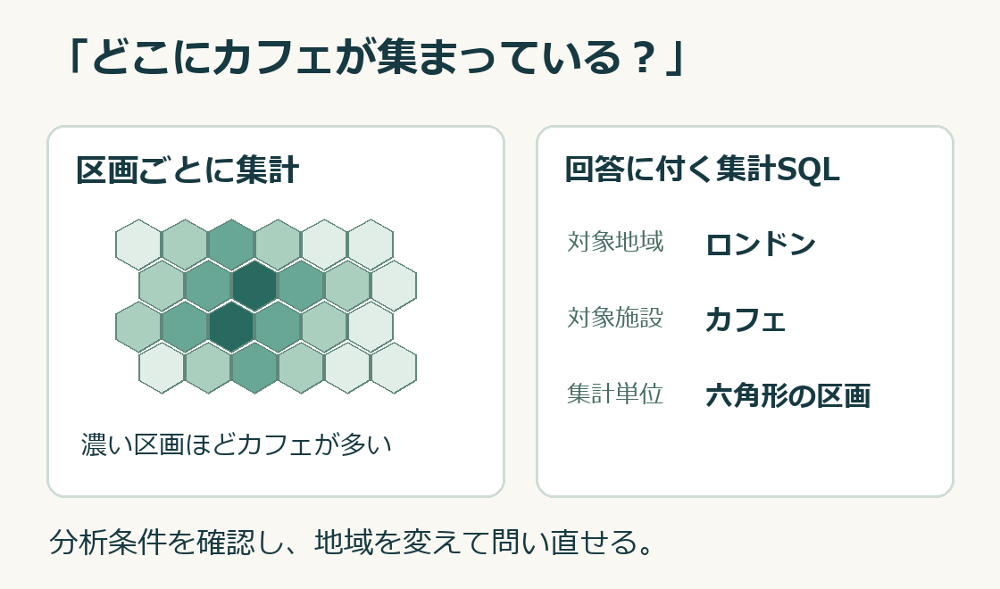
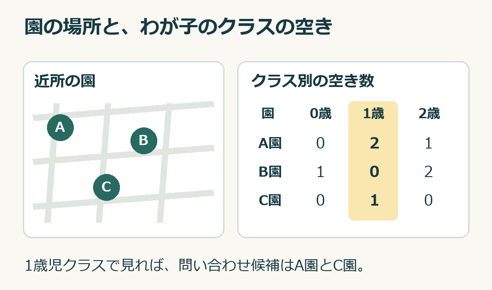

# 週刊GeoAI #11（2026年11月13日）

商圏分析で知りたいことは、「この辺りにはどんなお店が多いのか」「次の出店候補ならどちらがよさそうか」といった、普段の言葉で表せることが多いと思います。Googleの今回の発表を見て、GISの操作やプログラミングを覚える前に、まず自分の疑問から分析を始められるようになってきたと感じました。

MapboxもChatGPT向けのプラグインを公開しました。普段から使っているチャットで、仕事の相談をしているうちに「それなら地図で見てみよう」と思える。これまで商圏分析を誰かに頼んでいた人が、自分でも試してみるきっかけになりそうです。

本誌では、地図・位置情報・POIなどの地理空間データを、機械学習やデータサイエンスの手法で分析・活用する領域をGeoAIと呼びます。

## 今週の注目ニュース

### 1. [Google、店舗や道路のデータを会話で分析できる環境を公開](<https://mapsplatform.google.com/resources/blog/meet-the-geospatial-analytics-playground-explore-maps-insights-with-ai/>)

「ロンドンでカフェが集中しているのはどこ？」。Googleが公開したGeospatial Analytics Playgroundでは、こうした問いを英語で入力すると、地域を六角形の区画に分けてカフェの集まりを調べられます。施設の分布のほか、道路の混雑やストリートビュー画像も分析対象です。回答には集計に使ったSQLが付くので、分析担当者は条件を確かめたり、Colab Enterpriseに引き継いで別の地域で試したりできます。

*Googleのカフェ分析例を基にした概念図。区画の配置と濃淡は架空です。*

### 2. [Mapbox、ChatGPT向けプラグインを公開](<https://www.mapbox.com/blog/introducing-the-mapbox-plugin-for-chatgpt>)

プラグインを追加してMapboxアカウントを連携すると、住所・施設の検索、複数の配送先を回る経路の計画、店舗候補地から車で15分以内に行ける範囲の表示などができます。Mapboxにはカード登録なしで試せるデモ枠があり、対象機能や利用量には上限があります。標準利用では、サービスごとの無料枠を超えた利用に料金がかかります。[Mapboxの利用条件](https://docs.mapbox.com/accounts/guides/demo-access/)

### 3. [TRUSTART、地球上の位置が定まっていない土地の図面を地図に重ねる整備を開始](<https://prtimes.jp/main/html/rd/p/000000117.000079172.html>)

登記所の図面には、土地同士の並びや形は分かっても、現実の地図のどこに重ねればよいか決まっていないものがあります。TRUSTARTは生成AIで手順とコードを作り、決めた計算で位置を合わせ、土地一筆ずつのずれを検証しました。同社によると、ずれの大きい筆を除いた東京23区の公開対象約267万筆では、約99％で**中心点**のずれが5m以内でした。

## 短報

### 4. [GeoLibre 3.7、屋内地図でフロアの切り替えに対応](<https://github.com/opengeos/GeoLibre/releases/tag/v3.7.0>)

対応形式の屋内地図を読み込むと、建物の階を切り替えて部屋の配置を確認できます。建物を外から眺めたあと、目的の部屋がある階に移れます。

### 5. [ArcGIS Survey123、写真や文章から調査票への入力を助けるAI機能を正式提供](<https://www.esri.com/arcgis-blog/products/survey123/announcements/whats-new-in-arcgis-survey123-november-2026>)

現場で撮った写真から情報を読み取り、調査票の別の設問に自動入力できます。AI解析には通信接続が必要で、ArcGIS Onlineのクレジットを消費します。

### 6. [SQLRooms、手元のDuckDBで地図を動かす仕組みを紹介](<https://duckdb.org/2026/11/12/local-analytics-without-a-database-server>)

Foursquareの分析アプリでは、利用者が見ている範囲に合わせてDuckDBが地図タイルを生成します。元データを手元で処理しながら、地図を引いて広域を眺めるときには表示を間引く工夫も紹介されています。

## 今週の地図

### 7. [東京駅から雨にぬれずにどこまで歩ける？　地下通路完全網羅マップ](<https://san-tatsu.jp/articles/555485/>)

大手町駅C2b出口から東銀座駅6番出口まで、地下通路だけで約2.5km。2026年9月に実際に歩いて調べた地図には、街区の下でつながるビルの通路も描かれています。通れる曜日・時間帯はビルによって異なります。

## 地図とAI、はじめの一歩

**近所の保育園に、うちの子のクラスの空きはある？**

*園名・位置・空き数は説明用の架空例です。*

保育園を探すとき、一覧で空きを見つけては住所を地図で調べ直すのはひと手間です。自治体によっては、園の場所と年齢別の空き状況を一緒に見られます。例えばつくば市では、市の案内ページの途中に操作できる地図があり、年齢を選んで園を絞れます。お住まいの地域でも「自治体名　保育園　空き状況　地図」で探してみてください。気になる園があったら、希望する入所月と更新日を確かめて、問い合わせ先の候補にできます。[つくば市の案内・地図](https://www.city.tsukuba.lg.jp/kosodate/oshirase/1005950.html)
