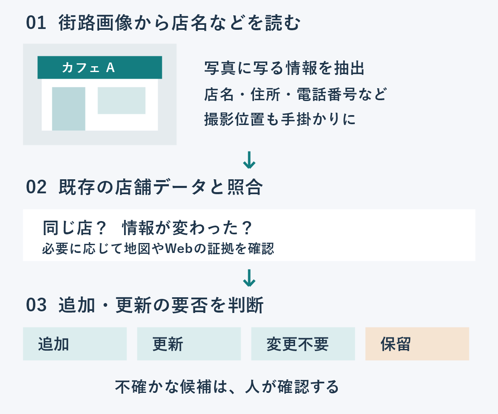
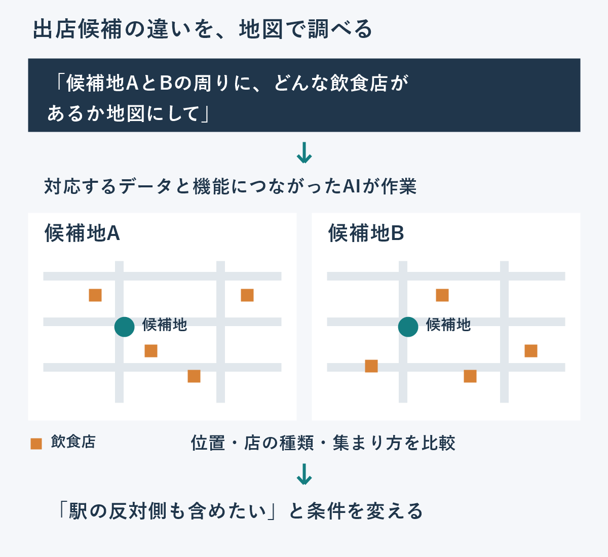

# 週刊GeoAI #12（2026年11月20日）

今週は、GeoAIやGISエージェントの入門記事を書きました。中でも、[「地図のAIエージェントは何ができる？」](https://blog.masahiko.info/entry/2026/11/14/113000)やGISエージェントの入門が比較的読まれています。地図の分析をAIにどこまで頼めるのか、関心を持ってもらえているのかもしれません。

GISの操作やプログラミングを自分で覚えなくても、普段の言葉で作業を頼める。「この駅の近くにはどんな店が多い？」と聞き、地図を見ながら条件を変える。そんな調べ方が身近になるのは楽しみです。

本誌では、地図・位置情報・POIなどの地理空間データを、機械学習やデータサイエンスの手法で分析・活用する領域をGeoAIと呼びます。

## 今週の注目ニュース

### 1. [街路画像から店舗情報の追加・更新を判断する「MAPS」](<https://arxiv.org/abs/2611.19807>)

看板から店名を読み取った後、その店を新しく登録するのか、既存の情報を直すのか。公開された研究「MAPS」は、画像から取り出した情報を既存の店舗データと照合し、追加・更新・変更不要・保留を判断します。不確かな候補は人が確認します。

著者らによる中国のKuaishouでの試行では、10万枚超を処理し、画像当たりの平均処理時間は人手の90秒に対して20.8秒だったと報告しています。誰でも使えるアプリの発表ではなく、店舗データを維持する仕組みの研究です。

*MAPS論文を基に作成した概念図。店舗名と配置は架空です。*

### 2. [Geolonia、Web地図描画ライブラリ「MachGL」を提供開始](<https://www.geolonia.com/news/2026-11-16-machgl-release/>)

以前紹介したMachGLが、11月16日に提供開始となりました。Webサイトに地図を表示するための部品で、PLATEAUの3D建物データを軽快に描画することを目指しています。既存のGeolonia Mapsの埋め込みから切り替えられ、利用にはGeoloniaのAPIキーが必要です。[公式デモ一覧](https://geolonia.github.io/machgl-apps/)も公開されています。

### 3. [NAVITIME、訪日客の滞在・周遊を条件指定で調べるAPIを提供開始](<https://prtimes.jp/main/html/rd/p/000000630.000026884.html>)

「何人来たか」に加え、「ほかにどこへ立ち寄ったか」「どの順番で移動したか」を集計できる法人向けサービスです。調べたい範囲、期間、国・地域などを指定し、結果を自社の分析環境へ取り込めます。観光地同士の連携や交通の検討に使うことを想定しており、前日までのデータを扱えるかは契約プランによります。

## 短報

### 4. [Overture Maps、11月版で店舗の住所・電話番号を正規化](<https://docs.overturemaps.org/blog/2026/11/18/release-notes/>)

国・地域コードや電話番号の表記をそろえ、約5,729万件の店舗・施設データの属性が変わりました。これらのIDは維持されており、変更件数がそのまま開店や移転の数を表すわけではありません。

### 5. [RustGIS 0.7、スマホでの現地調査に対応](<https://github.com/opengeos/RustGIS/releases/tag/v0.7.0>)

地図データを扱うGISアプリ「RustGIS」が、Android・iOSでのオフライン地図、現地での編集、写真・移動軌跡の記録に対応しました。現地の編集や写真を、元の地図プロジェクトへ戻す仕組みも備えます。

### 6. [Esri、会話から業務用の地図やアプリを組み立てる機能を紹介](<https://www.esri.com/arcgis-blog/products/arcgis-solutions/announcements/build-your-own-solution-with-the-arcgis-solutions-assistant>)

ArcGIS Solutions Assistantでは、「バス停を点検したい」といった要望から、必要なデータ項目や地図・アプリの構成を作成できます。既存ベータ機能の活用紹介で、作った構成を組織へ配置するにはCreator以上のユーザータイプが必要です。

## 今週の地図

### 7. [日本近海の「風浪」と「うねり」を色と動きで見る](<https://floris0807.github.io/30daymapchallenge-2026/day13-interactions/>)

その場の風が起こす波と、遠くから届く波を色分けし、風の流れや波の周期を動きで表した地図作品です。[制作記事](https://zenn.dev/floris0807/articles/e54e07bf1c404a)では11月13日時点の予報モデルの値を使っており、実測の観測値とは異なります。

## 地図とAI、はじめの一歩

**次のお店の候補地、まず何を見比べる？**

*利用場面を示す概念図。候補地・店舗・配置は架空で、特定製品の画面ではありません。*

次のお店を考える担当者なら、「候補地AとBの周りに、どんな飲食店があるか地図にして」と頼むところから始められます。対応するデータと機能につながったGISエージェントなら、検索や集計、地図作成を手伝えます。地図を見て「駅の反対側も含めたい」と条件を変えることもできます。出店先を決める前に、候補地の違いを調べる材料を作る。そんな使い方が入口になります。

詳しくは[「GISエージェント入門」](https://blog.masahiko.info/entry/2026/11/17/113000)で紹介しています。
