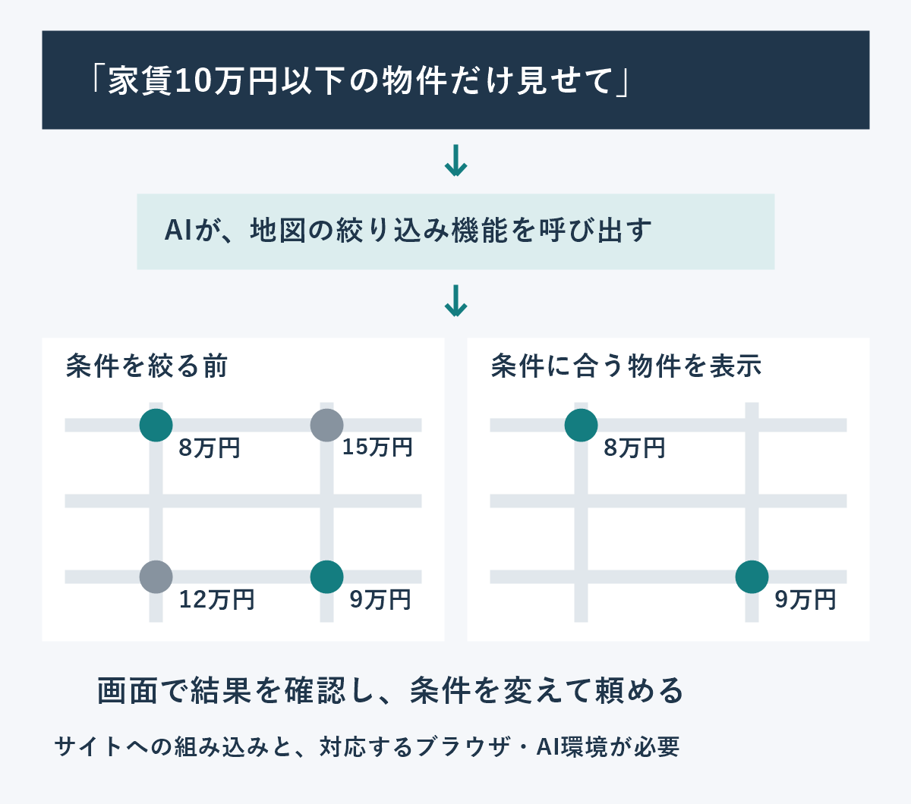
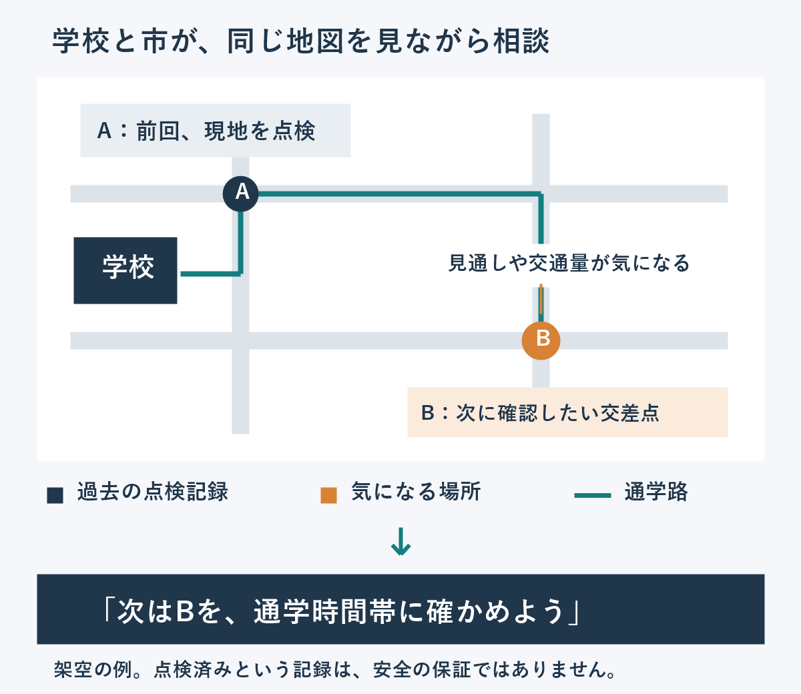

# 週刊GeoAI #13（2026年11月27日）

地図で条件を絞ったり、気になる場所を強調したりする操作も、普段の言葉で頼めるようになってきました。Mapboxの今回の発表は、Webサイトの地図をAIが実際に操作するための仕組みです。

サイト側の対応は必要ですが、「この条件に合う場所だけ見せて」と頼み、地図を見ながら条件を変える。そんな使い方が広がるのを楽しみにしています。

本誌では、地図・位置情報・POIなどの地理空間データを、機械学習やデータサイエンスの手法で分析・活用する領域をGeoAIと呼びます。

## 今週の注目ニュース

### 1. [Mapbox、Web地図をAIが操作するプラグインを公開](<https://www.mapbox.com/blog/introducing-the-mapbox-webmcp-plugin-for-gl-js>)

Mapboxが11月19日、Web地図とブラウザのAIエージェントをつなぐ「WebMCP」プラグインを公開プレビューとして提供しました。条件に合う物件だけを表示したり、気になる場所を強調したりする操作をAIに任せられます。

サイトの開発者による組み込みと、対応するブラウザ・AI環境が必要です。あらゆる地図をそのまま会話で操作できる機能ではなく、Mapboxの利用条件も適用されます。

*公式発表を基にした概念図。物件と地図は架空で、実際の製品画面ではありません。サイトへの組み込みと対応環境が必要です。*

### 2. [GeoParquet 2.0公開、地図データを一般の分析ツールで扱いやすく](<https://cloudnativegeo.org/blog/2026/11/geoparquet-2-0-released/>)

店舗の位置や建物の形を、売上などの表データと一緒に保存できるGeoParquetが、11月24日に2.0を正式公開しました。土台のParquet形式に備わった地理空間型を採用し、対応する分析ツールが位置・形状の列を直接認識できるようにしています。対象地域と関係のないデータの読み取りを省く仕組みも利用できます。

DuckDBやGeoPandasなどで対応が進んでいますが、読み書きできる範囲には違いがあります。古いツールを含めて広く配布する場合は、引き続き1.1が推奨されています。

### 3. [不動産情報ライブラリ、内水による浸水想定を地図とAPIで提供開始](<https://www.mlit.go.jp/report/press/tochi_fudousan_kensetsugyo17_hh_000001_00092.html>)

国土交通省が11月25日、雨水を排水しきれず浸水が想定される区域を追加しました。地価や都市計画などと重ねて確認でき、住まいや店舗候補地を調べる材料になります。システムへ組み込むためのAPI提供も始まりました。

ただし、[公式の出典表](https://www.reinfolib.mlit.go.jp/help/contents/)によると、画面の地図とAPIでは原典・整備時期が異なります。色がない場所を「浸水しない」と判断せず、収録範囲や自治体の案内も確認してください。

## 短報

### 4. [CARTO、外部ネットワークにつながず使えるAI対応GISを発表](<https://carto.com/blog/introducing-carto-air-gapped/>)

「CARTO Air-gapped」は、地図分析に加え、AIモデルや認証も組織内に置いて運用する構成です。機密性の高いデータを扱う企業・機関など、一部顧客への個別提供となります。

### 5. [GeoLibre、スマホ操作とブラウザでの分析を拡充](<https://github.com/opengeos/GeoLibre/releases/tag/v3.10.0>)

地図データを表示・分析するGISアプリ「GeoLibre」が、スマホ向けのタッチ操作やGPS位置での地点登録、ブラウザ内での経路・統計解析を拡充しました。3.10.0のデスクトップ起動問題などを直した[3.10.1](https://github.com/opengeos/GeoLibre/releases/tag/v3.10.1)も公開されています。

### 6. [Diground BIZ、建物のピンから部屋ごとの記録を管理](<https://prtimes.jp/main/html/rd/p/000000044.000023226.html>)

不動産管理や訪問業務向けに、建物のピンを開いて部屋ごとの記録・状況を確認する機能を追加しました。同じ建物に重なっていたピンを整理でき、BIZ契約者が利用できます。

## 地図とAI、はじめの一歩

**通学路のどこを、次に点検する？**

*弘前市とNECの実証を参考にした利用場面の概念図。場所や記録は架空で、安全性を判定した地図ではありません。*

学校と市の担当者が、通学路の気になる交差点や過去に点検した場所を、同じ地図で見ながら相談する。GISには、そんな使い方もあります。弘前市とNECの実証では、点検記録などを重ね、確認する場所を選ぶために活用しました。AIを使わなくても、「どこで何が気になっているか」を共有するだけで、地図は仕事の助けになります。現地で確かめる場所を話し合うところから始められます。

[実証の公式発表](https://prtimes.jp/main/html/rd/p/000001007.000078149.html)は2025年7月のものです。保護者向けの公開ルート検索ではなく、学校と自治体の業務での活用例として紹介しています。
